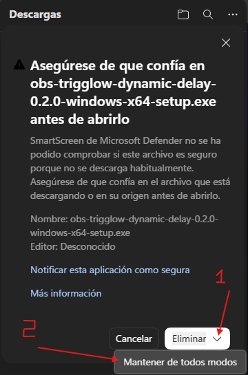
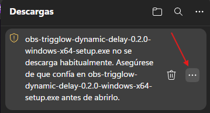
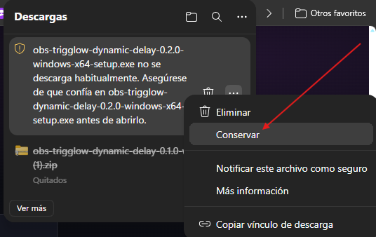
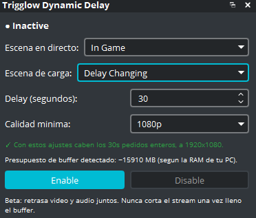
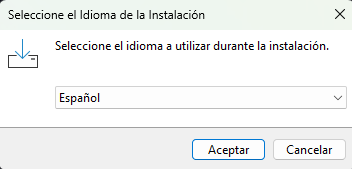
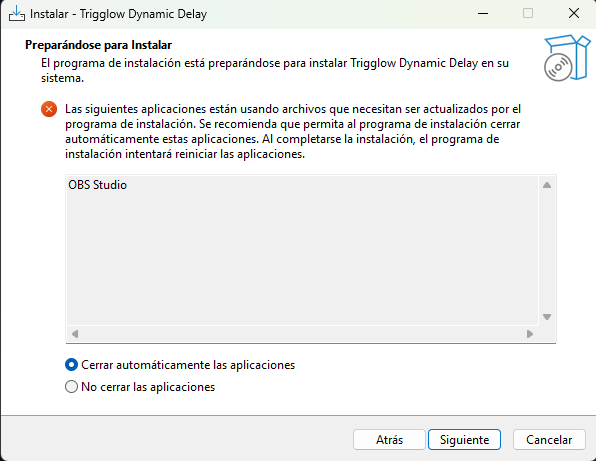
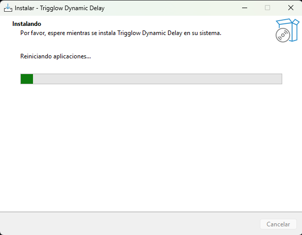
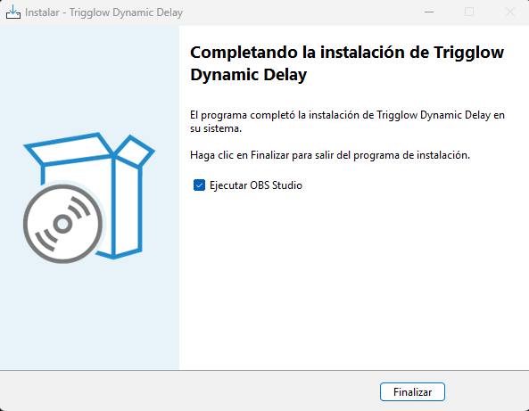
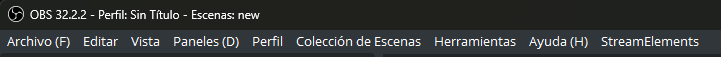
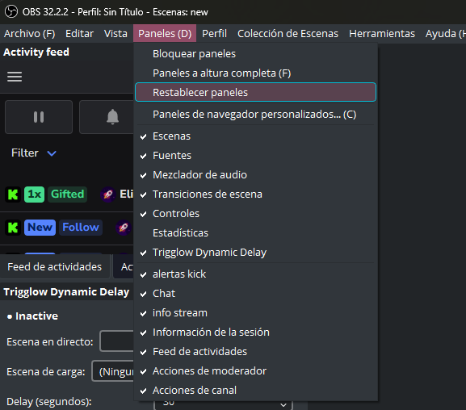

*[Versión en español](INSTALL_GUIDE-es.md)*

# Installation guide (step by step, with screenshots)

This walks through the Windows installer end to end, including the Microsoft Edge SmartScreen
warning you'll see because the installer isn't code-signed yet (Early Access — see
`docs/ROADMAP.md`). Screenshots below are from a real install on an older version, before v0.3.1
added the Trigglow icon/wizard banner shown in the installer today — the steps and layout are
otherwise unchanged, only that generic styling and the version number in the corner are out of date.
Since v0.7.1 there is no folder page and the installer asks you itself to close OBS (step 4).
Linux and macOS: see their sections below.

## Compatibility

| Plugin | Minimum OBS | Tested up to | Win | macOS | Linux |
|---|---|---|---|---|---|
| 0.7.1 | 31.1.0 | 32.2.2 | Installer, `.zip` (OBS 33 location) | `.pkg` | `.deb`, `.rpm`, `.pkg.tar.zst`, `.tar.xz` |
| 0.7.0 | 31.1.0 | 32.2.2 | Installer, `.zip` ("Legacy" in OBS 33) | `.pkg` | `.deb`, Ubuntu 24.04 with OBS 32.2 only |

"Tested up to" is the newest OBS the plugin was run in live (on Windows). OBS 33 is in release
candidate: v0.7.1 already installs where it looks for plugins, but hasn't been tested in it live. In
an OBS older than the minimum the plugin doesn't load, and says why in the OBS log. Linux and macOS
are covered below.

## 1. Download

Get `obs-trigglow-dynamic-delay-0.7.1-windows-x64-setup.exe` from the
[latest release](https://github.com/VirosMs/obs-trigglow-dynamic-delay/releases/latest). Prefer to
install by hand instead? The `.zip` in the same release contains just the plugin files — see
"Installing the plugin" in `README.md`.

## 2. Windows SmartScreen: why it appears, and how to get past it

Because the installer isn't signed with a code-signing certificate, Microsoft Defender SmartScreen
can't vouch for it and warns you before letting it run. This is expected for unsigned Early Access
software, not a sign that anything is wrong — but you should only click through it for installers
you actually trust the source of (in this case, the GitHub Releases page linked above).

Right after the download finishes, Edge shows this warning. Click **"Mantener de todos modos"**
("Keep anyway"):



If you closed that dialog, or you're coming back to it later from the Downloads list, click the
**"..."** menu next to the file instead:



...then choose **"Conservar"** ("Keep"):



Using a different browser? The warning and the exact button labels will look different (Chrome,
Firefox), but the underlying choice is the same: confirm you trust the file before opening it.

## 3. Close OBS before installing

**Install before you go live, not during a stream.** The installer needs to overwrite files that
OBS has open while it's running — if OBS is open when you start the install, it asks you to close it
(see step 4 below). Plan the install for before a session, not mid-broadcast.

## 4. Run the installer

It's a standard next-next-next wizard:

1. Pick a language:

   

2. Welcome screen — confirms the version being installed (shows 0.2.0 and Inno Setup's generic
   styling in this screenshot; as of v0.3.1 you'll see the Trigglow icon and banner instead, plus
   the current version number, but the same layout and buttons):

   

3. There is no folder to choose since v0.7.1: the plugin always goes to OBS's plugin folder,
   `C:\ProgramData\obs-studio\plugins\obs-trigglow-dynamic-delay` (see "Where the files go on
   Windows" below). The installer finds OBS through the registry key the official OBS installer
   writes and checks that it's OBS 31.1.0 or newer; with an older OBS it stops and asks you to
   update OBS first.

4. If OBS is still running, the installer asks you to close it (File → Exit) and click **Retry**.

5. Installing:

   

6. Done — optionally launch OBS Studio right away (it starts as your user, not as administrator):

   

## 5. Enable the dock in OBS

The dock doesn't always show up automatically the first time. In OBS's menu bar, open
**Paneles (View → Docks)**:



Either click **"Restablecer paneles"** ("Reset docks") or just make sure **"Trigglow Dynamic
Delay"** is checked in that same menu:



The dock appears, showing `● Inactive` — you're ready to pick a live scene and go. See `README.md`
("Using the plugin") for what to configure next.



## 6. Sign in once

`Enable delay` needs a free trigglow.com account, signed in once from the dock (Windows only for
now; macOS and Linux get sign-in with the HTTP client planned next, see `docs/ROADMAP.md`):

1. Press **Sign in** in the dock. Your browser opens trigglow.com; sign in there, or create a free
   account.
2. The dock shows a code ("The page must show the code KD7F-29QM."; yours is different). Check that
   the page shows the same code and press **Confirm**. If the codes don't match, or you didn't start
   it, press **It wasn't me**.
3. The dock says "Signed in as …" a few seconds later. You don't need to sign in again on the next
   start.

If the browser doesn't open, **Copy link** and paste it into your browser. More in the "Signing in
from the dock" section of `docs/TROUBLESHOOTING.md`.

## Linux

One x86_64 build of the plugin works on all of these; pick the package of your distro family (the
same formats as the Trigglow desktop app). Every package needs OBS Studio 31.1.0 or newer and Qt
6.4 or newer, and installs them, or refuses to install, through your package manager.

| Distro | Package | OBS Studio |
|---|---|---|
| Ubuntu 24.04 LTS | `.deb` | from the [OBS PPA](https://launchpad.net/~obsproject/+archive/ubuntu/obs-studio): Ubuntu's own is 30.0, too old |
| Ubuntu 26.04 LTS, 26.10 | `.deb` | Ubuntu's (32.1, 32.2) or the PPA |
| Debian 13 | `.deb` | Debian's is 30.2, below the minimum: the `.deb` refuses to install until an OBS 31.1 or newer is there |
| Linux Mint, Pop!_OS, other Ubuntu-based | `.deb` | as their Ubuntu base |
| Fedora | `.rpm` | Fedora's |
| openSUSE | `.rpm` | Packman's |
| Arch, Manjaro, EndeavourOS | `.pkg.tar.zst` | the distro's |
| Anything else (x86_64, glibc 2.39 or newer) | `.tar.xz` | yours, 31.1.0 or newer |

The Flatpak OBS isn't supported: it runs plugins inside its own runtime and keeps them elsewhere.

Install, with OBS closed:

```bash
sudo apt install ./obs-trigglow-dynamic-delay-0.7.1-x86_64-linux-gnu.deb   # Debian, Ubuntu
sudo dnf install ./obs-trigglow-dynamic-delay-0.7.1-x86_64-linux-gnu.rpm   # Fedora, openSUSE (zypper install)
sudo pacman -U obs-trigglow-dynamic-delay-0.7.1-x86_64-linux-gnu.pkg.tar.zst  # Arch
```

The packages put the plugin in OBS 33's system location,
`<libdir>/obs-modules/plugins/obs-trigglow-dynamic-delay.so` with its data in
`/usr/share/obs/obs-modules/plugins/obs-trigglow-dynamic-delay/`, and symlinks in the legacy
`<libdir>/obs-plugins/` and `/usr/share/obs/obs-plugins/` that OBS 31 and 32 read (`<libdir>`:
`/usr/lib/x86_64-linux-gnu`, `/usr/lib64` or `/usr/lib`). Remove it with your package manager
(`sudo apt remove obs-trigglow-dynamic-delay`, `dnf remove`, `pacman -R`).

**Per-user install (`.tar.xz`, no root):** extract it and run `./install.sh` as your own user. It
copies the plugin to `~/.local/share/obs-studio/plugins/obs-trigglow-dynamic-delay/` (OBS 33 and
later) and links it from `~/.config/obs-studio/plugins/obs-trigglow-dynamic-delay/bin/64bit/`
(OBS 31 and 32); `./install.sh --uninstall` removes both. Use either a package or the `.tar.xz`,
not both.

Your settings and sign-in (`~/.config/obs-studio/plugin_config/obs-trigglow-dynamic-delay/`) are
never touched by installing, updating or removing. Sign-in isn't available on Linux yet (see step
6).

## macOS

Install the `.pkg` from the same release. It goes to `~/Library/Application Support/obs-studio/plugins/`, which OBS 33 keeps using.

## Where the files go on Windows

Since v0.7.1 the installer puts the plugin in OBS's plugin folder for all users,
`C:\ProgramData\obs-studio\plugins\obs-trigglow-dynamic-delay\`, never in OBS's own folder:

- `obs-trigglow-dynamic-delay.dll` and its FFmpeg DLLs, which OBS 33 and later load;
- `bin\64bit\`, the same DLLs, for OBS 31 and 32 (OBS 33 skips them as a legacy duplicate);
- `data\`, shared by both.

Only administrators can change that folder, so no other user of the computer can add files next to
the plugin. The `.zip` contains the same `obs-trigglow-dynamic-delay` folder: to install by hand,
extract it into `C:\ProgramData\obs-studio\plugins\`.

## Updating from an earlier version

**From v0.7.0 or earlier on Windows**, those versions installed into OBS's own folder
(`C:\Program Files\obs-studio\obs-plugins\64bit\`), which OBS 33 marks as "Legacy" and OBS 34
won't load. The v0.7.1 installer moves it: it runs the old version's own uninstaller silently (only
after checking that its folder is an OBS folder with our files and that the uninstaller is that
install's), then removes anything of ours still left there (our DLL, our data folder, and the
FFmpeg DLLs only if they are the very ones the installer ships). OBS's other files and your
`plugin_config` (settings, sign-in) are left alone. If you had extracted the `.zip` into
`C:\ProgramData\obs-studio\plugins\` before, the installer simply updates it there.

**On Linux**, install the new package over the old one. The v0.7.0 `.deb` is replaced in place; if
you had copied the plugin by hand into `~/.config/obs-studio/plugins/`, delete that copy and use a
package or the `.tar.xz`'s `install.sh`.


Install the new version over the old one, the same way (with OBS closed): your scenes, settings and
hotkeys are kept. **From v0.5.x or earlier, updating is required**: the sign-in of those versions is
switched off when v0.6.0 is published, and the sign-ins they already have stop working after a
transition period. On the first start your sign-in moves to the new format by itself; if the dock
asks you to sign in, do it once (step 6). Since v0.6.0 the objects the plugin manages end in
"(auto)" instead of "(no tocar)": see `CHANGELOG.md` if a Stream Deck or obs-websocket action uses
them by name.
